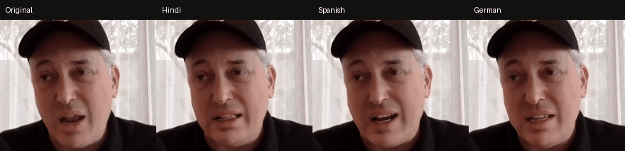

# Fit-to-clip dubbing (sync. API demo)

Give it a short talking head clip and an English script. An LLM translates the script into
each target language **under a time budget**, [sync.](https://sync.so) text to speech voices
it, the real duration is measured, and the line is rewritten until it fits the clip. Only then
does `lipsync-2` put the new line on the speaker's mouth.

```
"Thanks for watching. Today I want to show you..."  +  clip.mp4 (10.0 s, 29.97 fps)
        │
        ▼
 plan + budget check ─► clip length vs plan limit, worst case cost of the whole run, refuse before any call
        │
        ▼  for each language
 LLM translation ────► JSON {text, back_translation}, pydantic validated, budget of ~N characters
        │
        ▼
 precheck ───────────► predicted duration clearly too long? ask for a shorter line, no TTS spent
        │
        ▼
 sync /v2/tts ───────► measured duration, recalibrate characters per second for this voice
        │                 still too long? feed the measured overrun back to the LLM and rewrite
        ▼
 sync lipsync-2 ─────► sync_mode cut_off, Idempotency-Key, poll, download
        │
        ▼
 ledger + run.json ──► our estimate vs sync's estimate endpoint vs cost from the output frames
```

## Why fitting matters

A translation is usually a different length from the original line. With `sync_mode` set to
`cut_off`, audio that runs past the end of the video is clipped, so the dub loses its last
words. The other modes move the problem into the picture: `bounce` plays the video backwards,
`loop` repeats it, `remap` slows it down. The clean fix is upstream: make the line fit before
it reaches lipsync. Dubbing studios call this isochrony.

## Results from a real run

Clip: sync's [sample video](https://assets.sync.so/docs/example-video.mp4) (10.0 s, 29.97 fps).
Script: *"Thanks for watching. Today I want to show you how one video can speak to people in any
language, without losing a single word."* Translation `gpt-4.1-mini`, voice Roger, `lipsync-2`.



With sound: [Hindi](assets/hi.mp4) · [Spanish](assets/es.mp4) · [German](assets/de.mp4)
(free plan output, so it carries the sync watermark)

| | Line | Predicted | TTS measured | Output frames | Our estimate | sync estimate | From output frames |
|---|---|---|---|---|---|---|---|
| Hindi | 123 chars | 9.8 s | 9.3 s | 279 | $0.560 | $0.560 | $0.558 |
| Spanish | 123 chars | 7.9 s | 7.8 s | 233 | $0.470 | $0.470 | $0.466 |
| German | 106 chars | 7.3 s | 7.2 s | 217 | $0.434 | $0.430 | $0.434 |

Each language took about 2.5 minutes end to end (translation, TTS, upload, lipsync, download).
At Hobbyist prices the whole run is $1.46 of lipsync plus $0.10 of TTS. On the free plan it
cost nothing and used all 3 monthly lipsync generations.

**What I found while testing**

1. **A time budget makes the LLM cut meaning, not just words.** My first prompt said "shorter is
   fine". The Spanish line came back as "speak to anyone" instead of "speak to people in any
   language", a 6.7 s line for a 10 s clip that did not need cutting. The `back_translation`
   field is what made this visible without reading Spanish. The prompt now asks for a faithful
   translation first and only condenses when that would not fit. The Spanish back translation
   now matches the source word for word and still fits (7.8 s). German still drops "to people"
   with room to spare, so this is not fully solved.
2. **Frame rate changes the price.** Billing counts output frames, and all three outputs kept the
   source's 29.97 fps. sync's own estimate endpoint prices 8 s at $0.40 at 25 fps and $0.48 at
   30 fps. Because the estimator reads the clip's real fps, every estimate landed within half a
   cent of the cost computed from the delivered frames.
3. **The budget guard fired before anything ran.** With the default $2 cap, the worst case for
   three languages of a 10 s, 30 fps clip came to $2.23, so the run stopped before the first
   call. It went ahead with `--budget 3`.
4. **Every line fit on the first take on this clip**, so the rewrite path did not trigger. The
   real voice was close to the speaking rate priors (Hindi 13.2 characters per second against a
   prior of 12.5, Spanish 15.8 against 15.5, German 14.7 against 14.5). The rewrite path is
   covered by tests with a fake TTS. Tighter clips are where it earns its keep.

## Why it is built this way

- **Measure, do not guess.** The character budget from speaking rate priors is only a first
  guess. After the first TTS call the measured characters per second of that voice replaces
  the prior, so the rewrite target is based on the real voice.
- **Cheap checks before paid ones.** A line that is clearly too long is sent back to the LLM
  without spending a TTS call. Lipsync, the expensive step, only runs on a line that fits.
- **Give up honestly.** If a language still does not fit after the rewrite limit, it is
  skipped and reported, instead of paying for a dub with missing words.
- **Costs are checked three ways.** Our own estimate before the call, sync's
  `/v2/generations/estimate` endpoint (free, creates nothing), and the cost computed from the
  frames of the downloaded output, since billing counts output frames.
- **Frame rate aware pricing.** Per second prices assume 25 fps, but billing is per output
  frame, so the estimate reads the real fps of the clip. A 30 fps phone clip costs 1.2x the
  per second price.
- **Plan limits up front.** On the free plan a generation may be 20 s at most and there are 3 a
  month, so a 25 s clip or a 4 language run is refused before anything is sent.
- **Safe retries.** Lipsync creation is sent with an `Idempotency-Key`, so the SDK's automatic
  retries can never start (and bill) a second generation.
- **Dry run.** The whole flow, budget checks, fit loop, file layout and UI, runs with zero sync
  calls. The tests use it, plus fakes for the LLM and TTS.

## Run it

```bash
python -m venv .venv
.venv\Scripts\activate            # macOS/Linux: source .venv/bin/activate
pip install -r requirements.txt
cp .env.example .env              # add SYNC_API_KEY (and optionally an LLM key)
```

```bash
# free: are the keys set, which voices can I use, and sync's own price at 25 vs 30 fps
python cli.py --check

# free: zero API calls
python cli.py "Thanks for watching." --video clip.mp4 --langs hi,es,de --dry-run --no-llm

# real: the run above, one lipsync generation per language (the free plan has 3 a month)
python cli.py "Thanks for watching. Today I want to show you how one video can speak to people in any language, without losing a single word." --video https://assets.sync.so/docs/example-video.mp4 --langs hi,es,de --voice CwhRBWXzGAHq8TQ4Fs17 --budget 3

# README GIF from one or more runs, cropped to the face
CROP=760:640:580:180 python scripts/make_gif.py assets/dubs.gif outputs/<run-folder>

# web UI at http://127.0.0.1:7860
python app.py
```

```bash
pytest -q
```

## Cost reference

Hobbyist / Creator prices from the [billing docs](https://sync.so/docs/product/billing).

| Job | Price |
|---|---|
| `lipsync-2` | $0.05 per second at 25 fps ($0.06 per second at 30 fps) |
| `lipsync-2-pro` | $0.083 per second at 25 fps |
| text to speech | $0.004 per second of audio |
| the run above (3 languages, 7 to 9 s each, 29.97 fps) | $1.46 lipsync + $0.10 TTS |

The free plan gives 3 lipsync generations (20 s max, watermarked) and 10 TTS calls a month.

## Project layout

```
fitdub/
  translate.py  LLM translation under a character budget, JSON + pydantic, shorten on feedback
  timing.py     speaking rate priors, character budget, fit check
  fit.py        the fit loop: translate, precheck, TTS, measure, rewrite
  sync_api.py   sync calls (SDK for generations, REST for TTS and estimates) and the dry run
  costs.py      frame based pricing, plan limits, the budget ledger
  pipeline.py   probe clip -> limits and budget -> fit -> lipsync -> run.json
cli.py          command line
app.py          Gradio UI
scripts/        side by side GIF for this README
tests/          pricing, the fit loop with fakes, a full dry run
```

## Next steps

- Fit per sentence instead of per clip: transcribe the source, align sentences to timestamps,
  and fit each one to its own window with the Segments API
- Clone the speaker's voice (`POST /v2/voices`) so the dub sounds like the person on screen
- Score the output automatically, for example a SyncNet style audio visual offset and
  confidence per language, so prompt or model changes can be compared with numbers
- Use webhooks instead of polling, and batch many clips with the Batch API
